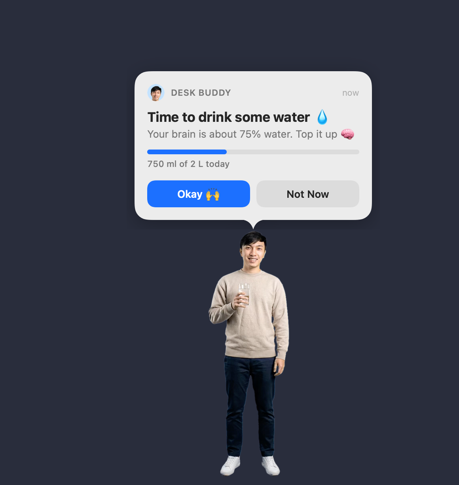

# HR Homie

A macOS menu-bar app that keeps colleagues healthy at the desk. Aiman walks onto the bottom-left of the screen and a
bubble over his head asks for a break. He waits there until someone answers **Okay 🙌** or **Not Now**. Clicks pass
through everything except the bubble, and nothing appears while you're away from the Mac or it's locked.

**Watch the intro (78 s):** https://video.respond.io/s/wbxysh2zjfaa8mj

Four reminders, each switched on or off in the menu (**Reminders**):

| Reminder | When | Okay 🙌 |
|---|---|---|
| 💧 Water | every 30 min | "Cheers! 🥂": he raises his glass to you, drinks (blue drops spray from the glass), thumbs up; logs 125 ml |
| 👀 Eye break | after 20 min of continuous screen use | the screen blurs with a 20 s timer in the middle while he looks far away (Skip is always there), then "Eyes rested ✅" |
| 🚶 Movement break | after 60 min of continuous use | "Let's go! 🚶" and he walks off with you |
| 🕌 Prayer time | at each of the five daily prayers in Kuala Lumpur (or 5–15 min before) | a second character, Hussein, in traditional Yemeni dress: "It's prayer time, let's pray! 🕌"; he beckons and walks off. Not Now: he looks sad and walks off head down ("Okay… 😔 Don't be too late"), back in 5 minutes while it's still that prayer's time |

Prayer times come from JAKIM's official e-Solat timetable for zone WLY01 (Kuala Lumpur). The current year ships in
the app (`Resources/takwim-WLY01-2026.json`); later years are downloaded once and kept for offline use. Each prayer
is announced once; after "Okay" the other reminders stay quiet for 20 minutes. On Fridays Zohor shows as Jumaat.

"Continuous" resets when you step away (2 minutes for the eyes, 5 for moving).

The little things:
- **Leaving**: he heads for the nearest screen edge and goes all the way, with real footage for each direction (never
  mirrored): after a drink he jogs off happily, otherwise he walks. Past the filmed part, an in-place walk or run
  cycle cut from his own steps takes over while the window moves at his real speed, so his feet don't slide.
- **Pick him up**: drag him anywhere. He dangles and kicks in panic; let go and he drops to the bottom of the screen,
  lands with a stumble, dusts himself off and gives you a look ("Put me down gently next time 😤").
- **He sits on your window**: sometimes (menu: Where He Shows Up) he climbs up from behind the window you're working
  in and sits on its top edge, legs dangling. Move the window and he rides along, wobbling; close it and he falls.
  When you answer he climbs back down behind it. Needs room above the window for him and the bubble, so it doesn't
  happen with maximised windows. Try it: Remind Me Now → 🪟 💧 Water, on My Window.
- **Poke him** while he waits: click on him and he giggles or goes "hey!"; every third poke he spins round, dizzy.
- **Peekaboo**: once a day, at a random moment, he leans in from the edge of the screen, waves and ducks away
  (menu: 👋 Peekaboo Visits; try it with Remind Me Now → 👋 Peekaboo).
- **Not Now** makes him sad: a pout, a sigh, and he trudges off with his head down.
- The line under the title rotates and fits the moment: "New week, fresh glass 💧" on Monday morning, "Last sips of
  the week 🎉" on Friday afternoon, "Coffee doesn't count. I checked ☕️"…
- The **Not Now** line gets more dramatic every time ("Fine 🙄", "Again? 🥲", "Not now, not now… 😤", …) and he's back in
  10 seconds (menu: “Not Now” Waits). After two snoozes he opens with "You said “not now” 2 times. Now is now 😤".
- Milestones: "Halfway there! 🙌", and at the daily goal "Goal reached! 🎉" with confetti on his thumbs-up and a fanfare.
- Streaks: "🔥 3 days in a row!" for meeting the goal on consecutive days (also in the menu).
- The menu-bar drop fills up as the day's water adds up (today's total is in its menu). On a MacBook with a full menu
  bar, macOS hides the leftmost icons behind the notch: opening the app again pops its menu up at the mouse pointer;
  ⌘-drag the drop further right, or turn other icons off in System Settings › Menu Bar.



## Build

Needs macOS 13+ and the Xcode Command Line Tools (full Xcode isn't required).

```bash
scripts/build-app.sh --open
```

That builds `build/HR Homie.app` (universal) and the disk image to share.

## Share with colleagues

`scripts/build-app.sh` also makes `build/HR-Homie-<version>.dmg` (universal, drag to Applications). Send that
with [docs/INSTALL.md](docs/INSTALL.md): the app is ad-hoc signed, so the first open needs **Open Anyway** in
System Settings → Privacy & Security (a Developer ID certificate and notarisation would remove that step). The
bundle identifier stays `com.shuvo.deskbuddy` from the app's earlier name, so settings carry over and a newly opened
copy replaces any older one.

## Security and privacy

HR Homie never reads passwords, secrets, the keychain, the clipboard, the camera or the microphone, and it asks
for no permissions. Everything it can see or do:

| What | What the app does | Where |
|---|---|---|
| Keyboard | Never watched. The eye and walk timers only ask macOS how many seconds have passed since the last input of any kind, not which key it was | `AppDelegate.swift` (`CGEventSource.secondsSinceLastEventType`) |
| Mouse | Only the pointer's position (mouse moves and drags), so a click on him or on the bubble lands and every other click passes through. It never sees what you click in other apps | `BuddyController.swift` (`startMouseTracking`) |
| Windows | For "sits on your window": the position and size of the front app's windows. No titles and no contents (those would need Screen Recording permission, which the app never asks for) | `Windows.swift` |
| Network | One HTTPS request: the official JAKIM e-Solat prayer timetable for zone WLY01, sending only the zone and a date range. The current year ships in the app, so this happens about once a year | `PrayerTimes.swift` |
| Storage | Settings and the day's water count in the app's own preferences (`UserDefaults`), and the cached timetable in Application Support. Nothing is uploaded | `Store.swift`, `PrayerTimes.swift` |
| Other apps | Quits other running copies of HR Homie itself (same bundle identifier), nothing else | `AppDelegate.swift` (`quitOtherCopies`) |
| Login | Starts at login only when you turn on **Open at Login** (`SMAppService`) | `AppDelegate.swift` |

`--snapshot` and `--demo` are developer test modes that render the corner to a PNG or capture the screen. They run
only when the binary is started from Terminal with those flags, and screen capture needs Screen Recording
permission, which macOS asks for first. Opening the app normally never runs them.

**Distribution is the weak point, not the app.** The app is ad-hoc signed and not notarised, so macOS can't confirm
who built it or that nobody changed it; that's why the first open needs **Open Anyway**. Until it's signed with a
Developer ID and notarised (which removes the warning):

- Share the DMG from one place only, and post its SHA-256 alongside it. Anyone can check their download with
  `shasum -a 256 HR-Homie-1.0.0.dmg`. The 1.0.0 DMG shared on 16 October 2026 is
  `ce8d161e29f0ee96472ba1b5044b12b0ef70522f93b0c6cc79251214d5b21388`; a rebuild gives a new hash.
- Don't open copies passed on from anywhere else.
- Company Macs under device management may block unsigned apps; check with IT before rolling it out widely.

## How it's put together

| Part | File |
|---|---|
| Schedule, menu-bar item and settings | `Sources/DeskBuddy/AppDelegate.swift`, `Store.swift` |
| The transparent corner panel, click pass-through, walk in → wait → drink/leave | `BuddyController.swift` |
| Clip playback (HEVC with alpha via AVFoundation, seamless or cross-faded switches) | `ClipPlayerView.swift` |
| The speech bubble (SwiftUI) | `PopupView.swift` |
| `DeskBuddy --snapshot out.png [mode]`: renders the corner without a window | `Snapshot.swift` |
| `DeskBuddy --demo [dir]`: a scripted visit (drop mid-screen, Not Now, walk off) logging his position and saving captures | `Demo.swift` |

The clips in `Resources/clips/` come from AI-generated footage of Aiman (made from one photo, keyed off a green
screen) in the `desk-buddy-real` video project. `scripts/make_clips.py <project dir>` rebuilds them: it puts every clip
on the same transparent stage (left edge = screen edge, head and feet at fixed points, walk-in motion baked in) and
encodes HEVC with alpha. A real 30-second phone video of Aiman against a plain wall would give a truer likeness and
goes through the same steps.
